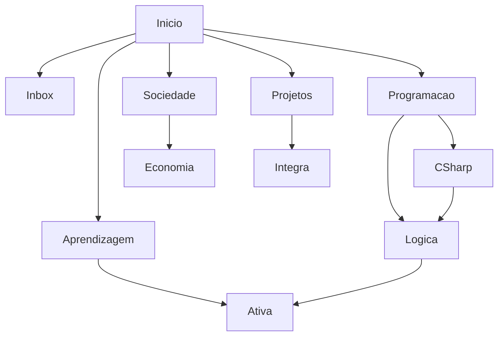

# Grafo e navegação

## O que o grafo mostra
No Obsidian, cada nota é um nó e cada wikilink é uma conexão. O grafo ajuda a explorar agrupamentos, notas isoladas e relações.

## Como evitar um grafo inútil
- Conecte notas quando houver relação intelectual real.
- Use MOCs como pontos de entrada.
- Evite links genéricos em todas as notas.
- Use busca para encontrar conteúdo; grafo para explorar relações.

## Visualizações
- Graph view global: estrutura geral.
- Local graph: vizinhança de uma nota.
- Filtros por pasta, tag ou tipo: reduzem ruído.

## Grafo conceitual inicial

As ligações reais são os wikilinks presentes nas notas.